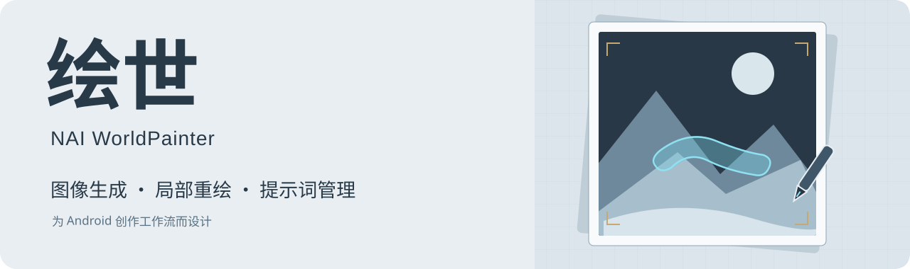

<div align="center">



# NAI WorldPainter · 绘世

**在手机上整理灵感、生成画面，再把细节慢慢画好。**

面向 Android 的 NovelAI 创作客户端，集成图像生成、局部重绘、提示词笔记本与 AI 助手。

[](https://github.com/sakiko0901/NAI-WorldPainter/releases/latest/download/app-release.apk) [](#安装与开始使用)

[本次更新](#本次更新) · [功能说明](#功能说明) · [API 配置](#api-配置) · [开发与构建](#开发与构建)

</div>

## 本次更新

**1.2.4 / 220040 · 2026-10-28**

- **提示词随手存、随时用。** 正向提示词标题右侧新增「笔记本、复制、展开」，常用 tag 与提示词组合可以命名保存、搜索、编辑和复用。
- **圆形遮罩，画到哪里选到哪里。** 圆形笔刷不再额外扩展遮罩，涂抹边缘有蓝色高亮；画笔弹窗支持圆形、方形和 1–10 档大小。
- **修正重绘边缘杂色。** 请求与合成使用各自适合的遮罩，羽化只在选区内生效；删除绘制目标选择，画笔直接编辑遮罩。
- **工作区更集中。** 分辨率与换图入口放到左上方，扩展、羽化、重绘强度、色彩校正和忽略原图集中到可展开的工作区菜单。

[查看完整发布说明](docs/releases/2026-10-28-220040.md) · [所有版本](https://github.com/sakiko0901/NAI-WorldPainter/releases)

## 安装与开始使用

1. 下载 [最新版 app-release.apk](https://github.com/sakiko0901/NAI-WorldPainter/releases/latest/download/app-release.apk)，在 Android 上安装并打开「NAI 绘世」。
2. 进入 **工具 → API 配置**，在「API 与账号」页配置生成渠道和模型。官方账号与中转平台的填法见下方说明。
3. 回到 **创作**，填写正向、负向提示词，按需添加角色提示词；通过右上角的参数按钮调整尺寸、采样和数量。
4. 点击生成，查看结果并保存。需要修改局部时切换到 **局部重绘**，选择图片后涂抹遮罩。
5. 想用自然语言整理提示词，可进入 **AI 助手**，先在右上角设置中配置可用的聊天模型。

| 安装包信息 | 当前版本 |
| --- | --- |
| Android | 7.0 及以上（最低 API 24） |
| CPU 架构 | `arm64-v8a` |
| 版本 | `1.2.4`，Android versionCode `220040` |
| 文件大小 | 52,689,264 字节，约 50.2 MiB |
| 包名 | `com.naihuishi.nai_huishi` |
| 签名 | 沿用项目现有 Android Debug 证书，APK v2 校验通过 |
| 校验文件 | 发布页中的 `SHA256SUMS.txt` |

当前发布的是 Android 安装包。生成和 AI 助手需要自行配置相应服务；应用不附带 API Key 或模型服务额度。

## 功能说明

### 图像创作

- **文生图与图生图**：编辑正负提示词，导入图片，并控制图生图强度。
- **多角色提示词**：为角色分别设置描述、负面词和位置；可用能力随模型与渠道而变化。
- **生成参数**：分辨率、步数、采样器、噪声调度、CFG、种子及批量数量。
- **参考图**：Vibe Transfer、Vibe 编码库与独立 Precise Reference 配置。
- **生成预览与历史**：支持流式中间预览、批量结果切换、画廊回看和参数复用。查看旧图时保留选择，选中最新结果后恢复跟随。
- **V5 Medium / High**：支持对应模型的等级切换；具体模型命名和参数约束见 [渠道说明](docs/v5_effort_channels.md)。

### 局部重绘

工作区把原图、输出框和遮罩放在一起。可以移动图像、调整输出区域，再绘制需要重新生成的部分。

| 操作 | 行为 |
| --- | --- |
| 点击「画笔」 | 从底部弹出设置，选择圆形 / 方形笔刷及 1–10 档大小 |
| 圆形笔刷 | 遮罩保留实际涂抹范围，不额外扩展；边缘以蓝色高亮 |
| 方形笔刷 | 适合块状区域，可配合工作区中的方形遮罩扩展 |
| 橡皮与撤销 / 重做 | 修整笔迹或恢复工作区操作 |
| 工作区菜单 | 集中设置扩展、羽化、强度、色彩校正、忽略原图及清空笔迹与遮罩 |
| 重绘提示词 | 保留独立的正向、负向提示词和多角色设置 |
| 候选结果 | 对比候选图片，选择后应用到工作区，再保存合成结果 |

### 提示词笔记本

入口在 **创作 → 正向提示词标题右侧的书本图标**。

- 保存单个 tag，或把一整组提示词命名收藏。
- 按标题和内容搜索，列表直接显示标题与内容缩略预览。
- 一键复制，或导入当前正向提示词；导入时自动处理衔接处的逗号，保留内部权重和换行。
- 支持编辑、删除；笔记保存在设备本地，关闭应用后仍可使用。

### AI 助手与学习记忆

- 用自然语言描述画面，辅助整理提示词与角色设定。
- 输入栏的 **「+」** 收纳照片、文档和画风收藏入口。
- 左上角进入会话历史，右上角新建会话或打开设置；**学习记忆**位于会话历史面板内。
- 主模型与识图模型可分别配置；角色姓名、别名和标准穿搭可存入本地记忆。
- 候选记忆经确认后参与后续会话召回。详见 [助手记忆说明](docs/mobile_assistant_memory.md)。

### 工具与素材

| 功能 | 用途 |
| --- | --- |
| 图片解析 | 读取 NovelAI 元数据、调用 WD-Tagger，提取或复用提示词 |
| 元数据编辑 | 修改或清除支持格式中的元数据，另存副本 |
| 导演工具 | 背景处理、线稿、草图、上色与表情等图像操作 |
| 官方 Upscale | NovelAI 官方图像放大 |
| 在线图库 | 浏览公开作品，查看并复用提示词 |
| 画师串与 Vibe 编码库 | 管理画风描述、权重和已保存的氛围编码 |
| 漫画生成 | 管理分镜项目、候选主图与本地对白后期 |
| 主题与外观 | 切换明暗主题和毛玻璃效果 |

## API 配置

打开 **工具 → API 配置 → NovelAI 官方 → 设置 URL 与 API Key**。

| 配置 | 官方渠道 | 自定义原生中转 |
| --- | --- | --- |
| URL | 留空；界面以暗色提示 `https://image.novelai.net` | 填写平台提供的 URL |
| 凭据 | NovelAI Persistent API Token | 该中转平台的 API Key |
| 模型 | 选择可用模型，也可点击「新增模型」手动填写名称 | 填写平台实际支持的模型名称 |
| 流式传输 | 通过「启用流式传输」开关控制 | 平台支持时开启；不支持时关闭 |
| 用量显示 | 有效官方账号可查看接口返回的体力与 Anlas 信息 | 不显示官方体力或积分 |

**自定义 URL 使用的是兼容 NovelAI 原生协议的渠道。** 其他协议的服务应使用对应的渠道配置；填写模型名称本身不会赋予账号该模型的调用权限。官方与不同自定义地址分别保存凭据。

精密参考当前使用非流式请求。第三方平台的模型、流式、图生图和重绘支持情况以其实现为准。

AI 助手的模型在 **AI 助手 → 右上角设置 → 模型配置**中管理，支持 OpenAI 兼容接口，并可分别绑定主模型与识图模型。

## 常见问题

<details>
<summary><b>升级会保留笔记、历史和配置吗？</b></summary>

同包名、同签名的覆盖安装通常会保留应用数据。本仓库当前 APK 沿用同一签名；不要为了升级先卸载旧版，卸载或清除应用数据会删除本地保存的内容。

</details>

<details>
<summary><b>为什么中转平台没有显示官方体力与积分？</b></summary>

填写自定义 URL 后按自定义渠道处理，不查询或展示官方账户配额。平台自己的额度请在相应平台查看。

</details>

<details>
<summary><b>开启流式后没有中间预览怎么办？</b></summary>

确认渠道和模型支持流式生成。自定义平台不支持时可关闭流式，使用完整结果返回模式；精密参考也使用非流式接口。

</details>

<details>
<summary><b>提示词笔记本与学习记忆有什么区别？</b></summary>

笔记本用于手动收藏、搜索和插入提示词。学习记忆用于让 AI 助手在后续会话中召回角色设定等已确认内容，两者入口和用途不同。

</details>

## 开发与构建

项目使用 Flutter / Dart，Android 配置位于 `android/`。以下命令从仓库根目录运行，需要先配置 Flutter、JDK 和 Android SDK：

```sh
git clone https://github.com/sakiko0901/NAI-WorldPainter.git
cd NAI-WorldPainter
flutter pub get
flutter test --no-pub --concurrency 2 --timeout 120s
flutter build apk --release --no-pub --split-per-abi --target-platform android-arm64
```

ARM64 输出：`build/app/outputs/flutter-apk/app-arm64-v8a-release.apk`。GitHub Releases 中将它命名为 `app-release.apk`。首次下载依赖后保留 `pubspec.lock`；当前 Android 工程使用 SDK 36 / NDK 28.2.13676358。

| 目录 | 内容 |
| --- | --- |
| `lib/presentation/` | 页面、界面组件、控制器与 ViewModel |
| `lib/domain/` | 业务实体、用例与重绘等领域服务 |
| `lib/data/` | 本地数据库、API 服务及仓库实现 |
| `lib/core/` | 依赖注入、队列、网络与通用工具 |
| `test/` | 业务、组件、请求协议与图像遮罩测试 |
| `docs/` | 功能说明、开发记录与发布说明 |

本次完整回归 **502 项通过、1 项跳过**；最终画笔样式调整后，14 项工作区页面测试再次通过。检查覆盖本地数据持久化、组件交互、模拟请求和遮罩像素，不代表真实付费 API 或全部 Android 设备均已验证。

## 文档导航

- [本次发布：笔记本与重绘工作区](docs/releases/2026-10-28-220040.md)
- [上一轮发布：界面与 NovelAI 渠道](docs/releases/2026-10-27-1.2.4.md)
- [V5 Medium / High 渠道说明](docs/v5_effort_channels.md)
- [在线图库](docs/online_gallery_mobile.md)
- [助手学习记忆](docs/mobile_assistant_memory.md)
- [架构地图](docs/architecture_map.md)与[前端开发指南](FRONTEND_GUIDE.md)（包含历史实现记录）

## 致谢

绘世是独立客户端项目，与 NovelAI 官方无隶属关系。感谢以下项目与作者提供的接口方案、标签检索和图像处理能力：

- [tt-P607/novelai-gateway](https://github.com/tt-P607/novelai-gateway) 与 [tt-P607/new-api](https://github.com/tt-P607/new-api)：NovelAI 兼容网关与接口方案参考。
- [SuzumiyaAkizuki/DanbooruSearchOnline](https://github.com/SuzumiyaAkizuki/DanbooruSearchOnline)：Danbooru 标签搜索与共现推荐；[在线服务](https://huggingface.co/spaces/SAkizuki/DanbooruSearch)、[数据库管线](https://github.com/SuzumiyaAkizuki/danbooru-tag-pipeline)、[上游许可证](https://github.com/SuzumiyaAkizuki/DanbooruSearchOnline/blob/main/LICENSE)。
- [SmilingWolf](https://huggingface.co/SmilingWolf)：WD-Tagger 模型。
- [Real-ESRGAN](https://github.com/xinntao/Real-ESRGAN) 与 [RealCUGAN-NCNN](https://github.com/nihui/realcugan-ncnn-vulkan)：项目中原生超分实现所使用的相关组件。

<div align="center">

[下载最新 APK](https://github.com/sakiko0901/NAI-WorldPainter/releases/latest/download/app-release.apk) · [报告问题](https://github.com/sakiko0901/NAI-WorldPainter/issues) · [查看源码](https://github.com/sakiko0901/NAI-WorldPainter/tree/master/lib)

</div>
